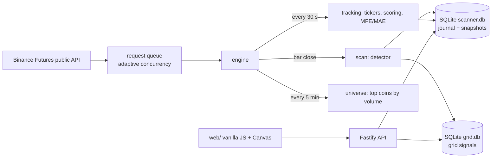

# Formation scanner

A forward-testing bench for chart-pattern hypotheses on Binance USDT-M futures.

You plug in a hypothesis: how to find a pattern, when it gives a signal and how to rate the outcome.
The engine scans the market at every bar close, records each signal with multi-timeframe chart
snapshots, follows the price until the outcome is scored and builds statistics. A parameter grid runs
hundreds of coefficient combinations on the same market events, so you can compare them. Results
are shown in a local web UI: a signal journal, live cards, a heat map of combinations and settings.

It suits structure-based setups (retracements, flags, breakouts). It does not trade, backtest on
history or handle indicator-only strategies. Statistics are collected forward on the live market, so
a hypothesis cannot peek into the future, but it takes days or weeks to accumulate.

> **The trading hypothesis is up to you.** This repository is the execution layer: data collection,
> scheduling, storage, scoring infrastructure and the UI. The hypothesis ships as a stub, and the
> parameter values are demo values. The app runs as is, but finds nothing until you plug in your own.

## Plugging in a hypothesis

| Function | File | What it decides |
|---|---|---|
| `detectPattern(bars, window, k)` | `src/core/detector.ts` | Whether the latest bars form a pattern: direction, anchor points A, B, C and level prices |
| `levelPrices(dir, A, B, k)` | `src/core/detector.ts` | Level prices from anchor points and coefficients `k1`–`k3` |
| `validCoefs(k)` | `src/core/detector.ts` | Which coefficient combinations the grid may try |
| `advance(state, dir, levels, lo, hi, t)` | `src/core/scoring.ts` | How a pattern moves through scoring stages, when the signal fires, the 0–4 score |
| `finalizeTtl(state, deadline)` | `src/core/scoring.ts` | The final score when time runs out |
| `signalPrice(levels)`, `exitPrice(score, levels, ref)` | `src/core/scoring.ts` | Prices recorded for the signal and for the close of an observation |

The engine only relies on these contracts: a pattern has anchor points and up to three levels set by
profile coefficients, scoring starts in stage `watch` and ends in `final` with a score from 0 to 4,
and the detector reads bars from the end of the array.

## How it works



- **Three loops.** The scan runs at each bar close of a profile's timeframe (plus a short delay). The
  tracking loop makes one tickers request for the whole market every 30 seconds. The universe loop
  refreshes the list of the most liquid coins every few minutes.
- **Observations.** A detected pattern goes under scoring. When scoring fires a signal, the engine
  writes a journal entry together with a chart snapshot in one transaction; fixing the score closes it
  with a second snapshot. MFE/MAE are tracked in between.
- **Parameter grid.** A profile can carry ranges instead of single values and expands into up to
  500 combinations. One bar download serves the whole grid, because the detector reads the array from
  the end. Combinations write a short row to a separate database instead of an ~80 KB snapshot.
- **No wasted requests.** Scoring advances on the bars the last scan already downloaded and goes to
  the exchange only when they don't cover the backlog (`scanCoverage`). All inserts of one scan pass
  go into a single transaction. The request queue halves its concurrency on HTTP 429/418 and ramps
  back up on success.
- **Restart-safe.** After downtime the engine restores open observations, catches up on missed bars,
  closes observations whose score was fixed while it was off and writes signals it missed.
- **Snapshots** are gzip containers with bars of five timeframes, the anchor points, levels and the
  profile that produced them.
- **API keys** (optional, read-only check) are stored encrypted with AES-256-GCM; the master key is
  generated locally in `data/config/`.

## Stack

Node.js ≥ 20, TypeScript (strict, run through `tsx` without a build step), Fastify 5, SQLite via
`better-sqlite3` in WAL mode, vanilla HTML/CSS/JS with hand-drawn Canvas 2D charts. Tests use the
built-in `node --test`.

## Run

```
npm install
npm start          # http://localhost:8787
npm test
npx tsc --noEmit
```

On Windows, `install.bat` and `start.bat` do the same; see `УСТАНОВКА.md` (in Russian). All data
stays in the local `data/` folder.

| Page | What it is |
|---|---|
| `/` | Signal journal: scores, filters, snapshot viewer |
| `/cards.html` | Live cards: patterns waiting for a signal and observations under scoring; scan profiles |
| `/grid.html` | Parameter grid: cost estimate, heat map of scores by combination |
| `/settings.html` | Update intensity, snapshot depth, API keys |
| `/dev.html` | Server health, request queue, detector check on one coin |
